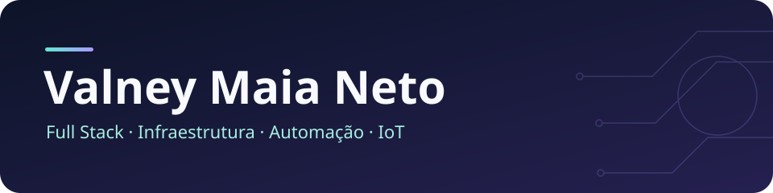

  Cientista da Computação e Desenvolvedor Full Stack com experiência prática em desenvolvimento web/mobile,
  automação, infraestrutura de redes, suporte técnico e IoT. Tenho vivência em ambientes reais de TI,
  atuando com sistemas, redes corporativas, dashboards, laboratórios acadêmicos e soluções em escala.

  Atualmente atuo com suporte técnico na Lanlink e sigo direcionando minha carreira para desenvolvimento
  de software, com foco em aplicações web, mobile, APIs, automações e soluções digitais.

  Meu diferencial está em unir desenvolvimento de software, visão de infraestrutura e capacidade de transformar
  problemas operacionais em soluções práticas, organizadas e escaláveis.

  
  &nbsp;
  
  &nbsp;
  
  &nbsp;
  

---

## Sobre mim

* Bacharel em Ciência da Computação pela Universidade Federal do Cariri - UFCA.
* Atuo atualmente com suporte técnico na Lanlink, em ambiente institucional.
* Experiência de 2,5 anos na Diretoria de Tecnologia da Informação da UFCA.
* Atuei com automação de laboratórios, administração de redes, dashboards, suporte técnico e documentação de infraestrutura.
* Tenho foco em desenvolvimento full stack, aplicações web/mobile, APIs, automações e soluções digitais.
* Interesses principais: desenvolvimento full stack, apps mobile, infraestrutura, IoT, automação e sistemas embarcados.

---

## Stack técnica

### 💻 Frontend & Mobile

  

 

### ⚙️ Backend & Banco de Dados

  

 

### 🛠️ Infraestrutura, Redes & DevOps

  

 

### 🔌 IoT & Sistemas Embarcados

  

---

## Experiência

### Suporte Técnico - Lanlink `Jun 2026 - Atual`

* Atendimento e suporte técnico a usuários em ambiente institucional.
* Tratamento de incidentes, requisições e problemas relacionados a sistemas, equipamentos e microinformática.
* Suporte presencial e remoto a computadores, notebooks, impressoras, scanners, webcams e aparelhos VoIP.
* Instalação, configuração e atualização de softwares, hardwares e imagens padrão de estações de trabalho.
* Apoio à infraestrutura de redes, incluindo Wi-Fi, access points, switches, firewalls e organização de racks.
* Controle de inventário de ativos de TIC, rotinas de backup/restauração e documentação de procedimentos técnicos.

### Residência Tecnológica | PNAAT · 2026 · 2 meses

* Atuei com sistemas embarcados, IoT e inteligência artificial na borda.
* Ao longo do programa, participei do desenvolvimento em equipe do **FlowCount**, de provas de conceito e de apresentações técnicas.
* Trabalhei com sensores, ESP32, Raspberry Pi e ferramentas de visão computacional como YOLO, Edge Impulse e TensorFlow Lite.
* Concluí a Trilha de Fundamentos e o Intensivo Maker e participei do Job Fair do programa.

[Formação PNAAT · Julho a setembro de 2026 · 234 horas](https://drive.google.com/drive/folders/1JQyTrCAfwsPMssvQza5Q3jZGHdgJlXeP?usp=drive_link)

### Bolsista PAP - DTI/UFCA `Jun 2023 - Dez 2025`

* Implantei o FOG Project para automatizar a clonagem e padronização de sistemas em **mais de 300 máquinas distribuídas em 10 laboratórios**.
* Administrei ativos de rede, incluindo switches Aruba e Access Points Ruckus, com apoio do HPE IMC para monitoramento e manutenção.
* Apoiei o gerenciamento de VLANs, VPNs e documentação técnica de ativos no NetBox.
* Desenvolvi dashboards no Looker Studio para controle patrimonial e inventário de bens de TI.
* Utilizei Veyon para monitoramento e controle remoto de laboratórios.
* Prestei suporte técnico nível 1 e 2 em ambientes Windows e Linux.
* Orientei estagiários em atividades técnicas de campo e padronização de procedimentos.

### Voluntário - Pensamento Computacional, UFCA `Jan 2024 - Dez 2024`

* Ministrei aulas de lógica de programação e introdução à eletrônica com Arduino para estudantes da rede pública.
* Desenvolvi atividades práticas com foco em aprendizagem criativa, raciocínio lógico, pensamento computacional e resolução de problemas.

---

## 📊 Atividade no GitHub

  

  

  
Linguagens mais usadas

   
  

---

## Formação & Certificações

**Bacharel em Ciência da Computação** - Universidade Federal do Cariri - UFCA

| Certificação                                                              | Instituição          | Carga |
| ------------------------------------------------------------------------- | -------------------- | ----- |
| Capacitação Profissional em Sistemas Embarcados                           | EmbarcaTech          | 160h  |
| Práticas de Cloud Services usando Swift com ênfase em Serviços Cognitivos | Eldorado / HackTruck | 100h  |
| Algoritmos e Programação Orientada a Objetos em Swift                     | Eldorado / HackTruck | 50h   |
| Fundamentos das Plataformas de Sensoriamento Inteligente para Indústria   | Virtus               | 20h   |
| Conceitos Básicos de Redes                                                | Cisco                | 20h   |

---

## Idiomas

**Português:** nativo
**Inglês:** intermediário em leitura e escrita técnica; básico em conversação

---

  Sempre aprendendo, sempre construindo.

